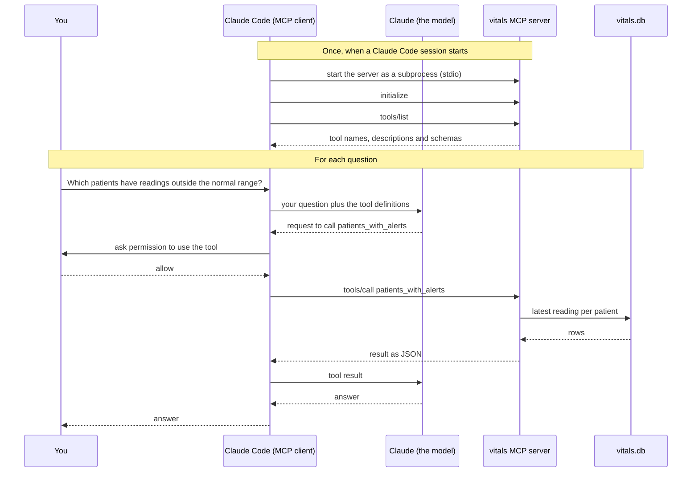

# vitals-api

A small FastAPI service for storing vital-sign readings and flagging worrying ones.
This is a learning project. All data is made up.

## MCP server

The project includes an MCP server with three read-only tools, so AI apps such as
Claude Code can query the stored readings.
It uses the stdio transport: the AI app starts the server as a subprocess and talks to it over standard input and output.

The alert thresholds are illustrative only. They are not clinical advice.

### How it works



Claude never talks to the server directly. Claude Code's MCP client does all of
the MCP communication. The database stays on your machine, and only tool results
are sent to Claude.

### Tools

| Tool | Parameters | Returns |
| --- | --- | --- |
| `latest_reading` | `patient_id`, e.g. `p-1` | The patient's most recent reading, or null if there is none. |
| `list_readings` | `patient_id`, and `limit` (1–100, default 10) | The patient's most recent readings, newest first, up to `limit` of them. |
| `patients_with_alerts` | none | Every patient whose **latest** reading is outside the normal range, sorted by `patient_id`. Each entry has the reading and its alerts. |

Each reading has an `id`, `patient_id`, `recorded_at` (UTC, ISO 8601),
`respiratory_rate_per_min` (breaths per minute), `heart_rate_bpm` (beats per minute)
and `spo2_percent` (oxygen saturation, %).

Each alert names the `field` that's out of range, its `value`, the `limit` it crossed,
and the `direction` (`below` or `above`).

The normal ranges are defined in `NORMAL_RANGES` in `src/vitals_api/queries.py`:

| Vital sign | Normal range |
| --- | --- |
| Respiratory rate | 12–20 breaths per minute |
| Heart rate | 50–100 beats per minute |
| SpO₂ | 94% or higher |

Values exactly on a limit count as normal.

### Before you start

- **Install:**
  - [uv](https://docs.astral.sh/uv/), to run the project. It installs the right Python version and the dependencies for you.
  - [Node.js](https://nodejs.org/), only for the MCP Inspector.
  - [Claude Code](https://claude.com/claude-code), to use the server from Claude.
- **Add some made-up readings.** The database starts empty.
  1. From the project folder, run `uv run fastapi dev src/vitals_api/main.py`.
  2. Open `http://127.0.0.1:8000/docs`, open `POST /readings`, and click **Try it out**.
     Send these readings **one at a time**:

     ```json
     {"patient_id": "p-1", "recorded_at": "2026-10-18T08:00:00Z", "respiratory_rate_per_min": 16, "heart_rate_bpm": 72, "spo2_percent": 98}
     ```

     ```json
     {"patient_id": "p-2", "recorded_at": "2026-10-18T08:05:00Z", "respiratory_rate_per_min": 18, "heart_rate_bpm": 118, "spo2_percent": 97}
     ```

     ```json
     {"patient_id": "p-3", "recorded_at": "2026-10-18T08:10:00Z", "respiratory_rate_per_min": 24, "heart_rate_bpm": 88, "spo2_percent": 91}
     ```

     That's one normal patient, one with a high heart rate, and one with a high
     respiratory rate and low SpO₂, so you'll see both normal and alert results.
     Each `POST` should return `201`.
  3. Stop the server with Ctrl+C.
- **Where the data lives:** by default, the database is `vitals.db` in the project
  folder. That stays true wherever the server is started from. To use a different
  file, set `VITALS_DB_PATH` in front of a command:

  ```
  VITALS_DB_PATH=/path/to/demo.db uv run mcp dev src/vitals_api/mcp_server.py
  ```

### Try it in the MCP Inspector

The MCP Inspector is a browser-based MCP client for testing servers. From the
project folder, run:

```
uv run mcp dev src/vitals_api/mcp_server.py
```

1. Open the URL it prints, and click **Connect**.
2. Go to the **Tools** tab and list the tools. You should see all three.
3. Run one, e.g. `patients_with_alerts`, or `latest_reading` with `p-2`.

The first run may ask to install the Inspector through `npx`. You may also see a
warning that Inspector v1 is deprecated. It still works for this.

### Connect it to Claude Code

Replace `/path/to/vitals-api` with the full path to your copy of the project:

```
claude mcp add vitals -- uv run --directory /path/to/vitals-api python -m vitals_api.mcp_server
```

- `vitals` is the name Claude Code shows for the server.
- Everything after `--` is the command Claude Code runs to start the server.
- To use a different database file, add `-e VITALS_DB_PATH=/path/to/demo.db`
  before the `--`.

By default, this adds the server for **this project folder only**. Check that it
connects with:

```
claude mcp list
```

`vitals` should show as **Connected**. To remove it again, run `claude mcp remove vitals`.

### Use it in Claude Code

1. **Start a new Claude Code session in the project folder.** Claude Code loads
   MCP servers when a session starts, so a session that was already running won't
   see the new server. In a terminal, run `cd /path/to/vitals-api`, then `claude`.
   Or open a new Claude Code tab in VS Code with this folder open.
2. Optional: type `/mcp` to see `vitals` and its three tools.
3. Ask: "Which patients have readings outside the normal range?"
4. Claude asks permission to use the tool, which shows as
   `mcp__vitals__patients_with_alerts`. Allow it.
5. Try a couple more questions, e.g. "What's p-1's latest reading?" or
   "Show me p-3's recent readings."
